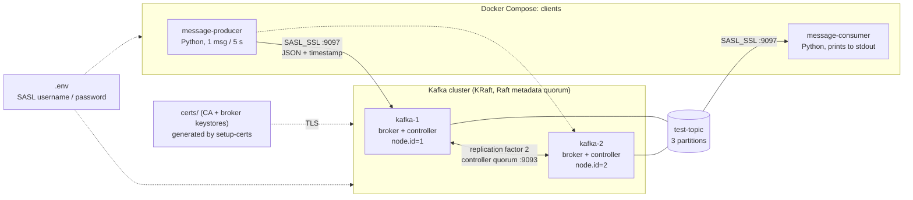

# Kafka DevOps Challenge

A Docker Compose environment with a 2-node Apache Kafka 4.0.1 cluster (KRaft, no Zookeeper),
TLS encryption, SASL/PLAIN authentication, and a Python producer and consumer.

## Architecture



| Item | Value |
| --- | --- |
| Kafka image | `apache/kafka:4.0.1` |
| Mode | KRaft, nodes `kafka-1` and `kafka-2` (broker + controller) |
| Client listener | `SASL_SSL` on `9097` (TLS + SASL/PLAIN) |
| Topic | `test-topic`, 3 partitions, replication factor 2 |
| Producer | one JSON message with a timestamp every 5 seconds |
| Consumer | reads `test-topic` and prints each message to stdout |

## Requirements

* Linux with Docker and Docker Compose v2
* OpenSSL and Java (`keytool`), both used by `scripts/setup-certs.sh`
* Python 3 (only for `kafka_manager.py`)

## Quick start

```bash
git clone https://github.com/alidz9-tech/kafka-devops-challenge.git
cd kafka-devops-challenge

cp .env.example .env
nano .env                       # set a real KAFKA_SASL_PASSWORD

./kafka_manager.py setup-certs  # CA, broker certs, keystores, truststores, JAAS
docker compose up --build -d
./kafka_manager.py create-topic --topic test-topic
./kafka_manager.py healthcheck
```

Watch the applications:

```bash
docker logs -f message-producer
docker logs -f message-consumer
```

## Commands

| Command | What it does |
| --- | --- |
| `./kafka_manager.py setup-certs` | Generates the CA, broker certificates, PKCS12 keystores, truststores and the JAAS file |
| `./kafka_manager.py create-topic --topic test-topic` | Creates the topic over `SASL_SSL` |
| `./kafka_manager.py healthcheck` | Checks containers, SASL_SSL connection, KRaft quorum, topic, partitions and ISR |
| `./kafka_manager.py test` | Sends a message and reads it back with a temporary consumer |
| `./kafka_manager.py failover --target kafka-1` | Stops one broker, waits, checks the other is running, restarts it |

The same operations are available as plain scripts in `scripts/`.

## Security

* Client traffic is encrypted with TLS on the `SASL_SSL` listener (`9097`).
* Clients authenticate with SASL/PLAIN. Credentials come from `.env`, which is git-ignored.
* Certificates, keystores and JAAS files are generated locally into `certs/` and are git-ignored.
* `.env.example` only holds a placeholder; replace it before use.

## Project layout

```text
docker-compose.yml      cluster + producer + consumer
kafka_manager.py        single CLI entry point
producer/               Dockerfile + producer.py
consumer/               Dockerfile + consumer.py
scripts/                setup-certs, create-topic, healthcheck, test-kafka, failover-test
```

## Troubleshooting

* Logs: `docker logs kafka-1`, `docker logs kafka-2`
* Full reset: `docker compose down -v && rm -rf certs && ./kafka_manager.py setup-certs && docker compose up --build -d`

