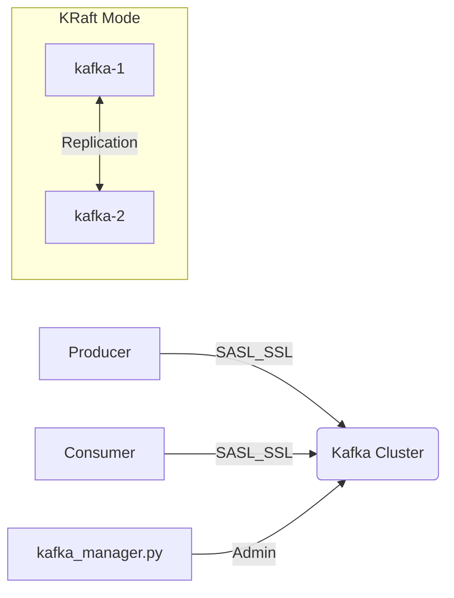

# Kafka DevOps Challenge

A production-style Apache Kafka setup using Docker Compose with a **Unified Python CLI**.

> 💡 **Note:** All operations are automated via `kafka_manager.py`.

## 🚀 Quick Start

1. **Clone & Configure:**
   ```bash
   git clone https://github.com/alidz9-tech/kafka-devops-challenge.git
   cd kafka-devops-challenge
   cp .env.example .env
   ```

2. **Launch:**
   ```bash
   ./kafka_manager.py setup-certs
   docker compose up --build -d
   ./kafka_manager.py create-topic --topic test-topic
   ./kafka_manager.py healthcheck
   ```

3. **Test Failover:**
   ```bash
   ./kafka_manager.py failover --target kafka-1
   ```

## Architecture



## Features
* 2 Kafka brokers (KRaft mode)
* SASL/PLAIN authentication & TLS 1.3
* Replication Factor = 2
* Automated health checks & failover testing

## Unified CLI Reference

| Command | Description |
| :--- | :--- |
| `setup-certs` | Generates SSL/TLS certificates |
| `create-topic` | Creates topic via SASL_SSL |
| `healthcheck` | 6-step system validation |
| `failover` | Simulates broker failure |
| `test` | End-to-end message test |

## Troubleshooting
* **Reset Cluster:** `docker compose down -v` then `./kafka_manager.py setup-certs` and `docker compose up --build -d`
* **Logs:** `docker logs kafka-1`
